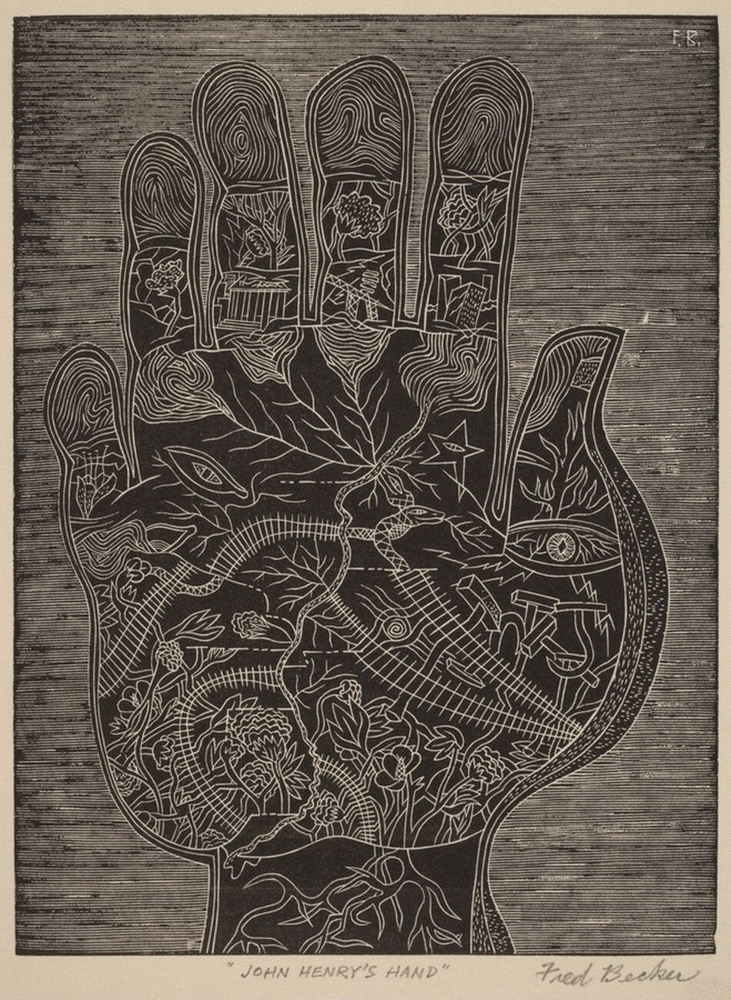
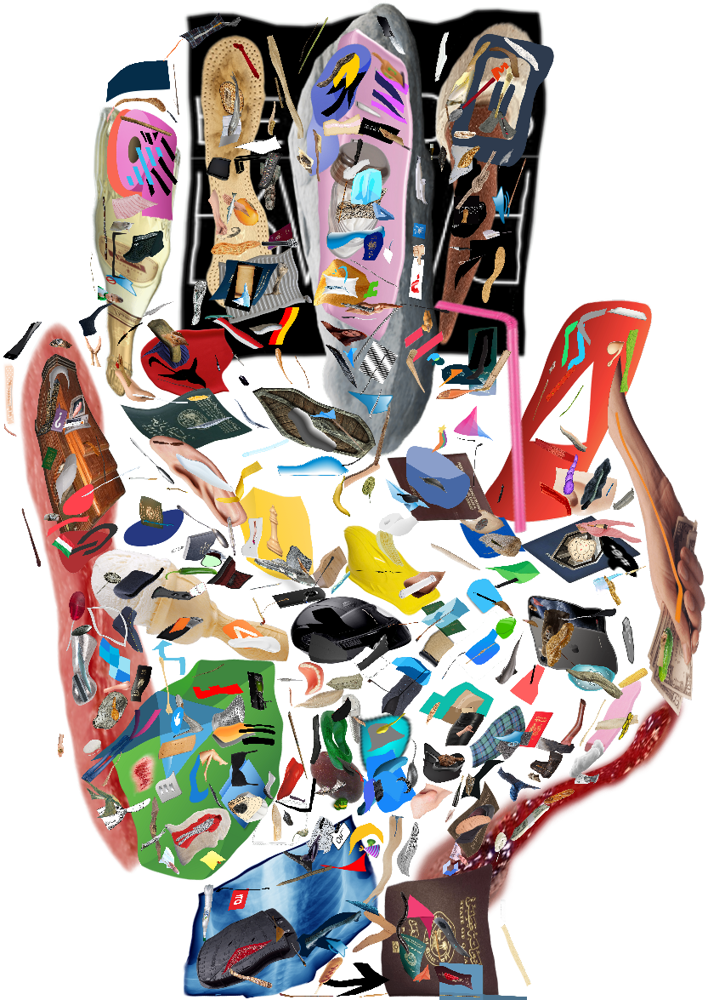

# image_fitter

Rebuilds a picture out of a library of transparent icons. Each icon is moved, scaled, rotated and
gently warped so that its outlines land on the line work of a target image (the *primary*). The
finished piece shows only the icons, at full opacity and in their original colours, with smaller
icons drawn on top of larger ones.

The primary here is Fred Becker's wood engraving *John Henry's Hand* (1935), cut out from its
background (`data/hand_cutout.png`). The library is ~50,000 transparent PNGs; it is not part of
this repository.

## The engraving



> Fred Becker, [*John Henry's Hand*](https://americanart.si.edu/artwork/john-henrys-hand-1691),
> 1935, wood engraving, image: 6 1⁄8 x 4 5⁄8 in. (15.4 x 11.6 cm), Smithsonian American Art
> Museum, Transfer from D.C. Public Library, 1967.72.30

## The result



*The current best result (v14): 506 library icons, warped and placed so their outlines trace the
engraving's lines. Only the icons are drawn.*

## How it works

1. **Outlines.** The primary's strokes are thinned to centre lines and sampled every ~3 px
   (`--prim-edges centerline --prim-spacing 0.008`). Each icon contributes its silhouette and
   its interior detail edges (`--icon-edges detail`).
2. **Placement search** (`src/cover_align.py`). For one icon against what is still uncovered: a
   global search over rotation, scale, stretch, mirroring and position; ICP refinement; then a
   smooth non-rigid warp with fold and collapse guards. Small icons are held to proportionally
   tighter tolerances (`--fine-ref`), and big icons must trace lines within 8 px (`--max-tol`).
3. **Score.** Primary line points newly covered by the icon's outline, minus penalties for icon
   outline that lands on nothing (`--alpha`), for re-covering covered lines (`--beta`) and for
   credit a busy texture would collect by chance (`--gamma`).
4. **Visible coverage only** (`src/occlusion.py`, `--occlusion`). Since smaller icons are drawn
   over larger ones, an icon's gain is what it adds that stays visible, minus the covered outline
   of larger icons it would hide.
5. **Greedy selection** (`src/cover_ranked.py`). Each round a learned scorer (`src/scorer.py`)
   shortlists library icons, every one is aligned against the remainder, and the best are placed
   (`--picks`). Placements that still pay are re-fitted in later rounds (`--reuse`). Within a stage
   no icon is tried twice. When nothing pays, `--stages` steps down to a lower stray penalty with a
   smaller size cap, so the late, small icons are less constrained.
6. **Render** (`src/render_overlay.py`). Draws the chosen placements, largest footprint first.

## Layout

| Path | Contents |
|---|---|
| `src/` | All code. Modules import each other by plain name, so run them as `python src/<module>.py`. |
| `configs/` | The search flags of each run (`flags_vN.txt`). |
| `data/` | The primary and its source engraving, and `excluded.txt`: library images rejected by hand, relative to the library root. |
| `docs/` | README images, and how the hand was cut out of the engraving (`segmentation_steps/`). |
| `scripts/runs/` | One script per run, with that run's full command line. |
| `scripts/` | `resume.sh RUN`, `pause.sh RUN` and `schedule.sh RUN 'YYYY-MM-DD HH:MM:SS'`: start, stop or schedule a run as a systemd user service. |
| `runs/` | Not tracked: outputs, checkpoints, trained scorers, library embeddings and caches. |

### Source files

| File | Role |
|---|---|
| `cover_align.py` | Shapes and edges, placement search, warp, scoring, report. `--selftest` checks the solver on a synthetic case. |
| `cover_ranked.py` | The main search: scorer-ranked residual greedy over the whole library, with checkpoints, stages and occlusion. |
| `occlusion.py` | Footprints and visible-outline bookkeeping. |
| `render_overlay.py` | Renders a result JSON as the icons-only composite and a side-by-side image. |
| `scorer.py` | Trains the next-icon scorer (`train`) and embeds the library with it (`embed`). |
| `labels.py`, `make_labels.py`, `rescore.py` | Training labels for the scorer: the aligner's true gains on sampled states. |
| `style_embed.py`, `style_zeroshot.py`, `style_filter.py` | SigLIP embeddings and zero-shot style labels (glow, text, ...). |
| `eligible.py` | The list of library icons the search may use. It drops non-transparent images, glows and smoke, and `data/excluded.txt`. |
| `rank_icons.py` | An early whole-shape similarity ranking (not used by the current pipeline). |

## Running

```bash
python3.12 -m venv .venv
.venv/bin/pip install torch --index-url https://download.pytorch.org/whl/cpu
.venv/bin/pip install -r requirements.txt
.venv/bin/python src/cover_align.py --selftest

export LIBRARY=/path/to/transparent/icons
# library preparation: style labels, then the eligible list
.venv/bin/python src/style_embed.py $LIBRARY runs/siglip.npz
.venv/bin/python src/style_zeroshot.py runs/siglip.npz runs/style_labels.npz
.venv/bin/python src/eligible.py $LIBRARY runs/style_labels.npz runs/eligible.txt --exclude data/excluded.txt
# scorer: labels, training and library embedding (see scripts/runs/run_v4.sh), then a search run:
scripts/resume.sh v13        # runs scripts/runs/run_v13.sh in the background; log in runs/v13.log
scripts/pause.sh v13         # stop; resume.sh continues from the last finished round
```

Everything runs on CPU. A search round aligns 256 icons in 2–15 minutes on 15 worker processes, depending on the size range searched.

## Results

Coverage is the share of the primary's line points covered by icon outlines. From v12 on, only
outline still visible in the render counts, and big icons must be within 8 px. Earlier runs
counted hidden outline and allowed ~15 px, so their own figures read high. The strict column
re-measures them the v12 way.

| Run | Icons | Reported coverage | Strict (visible, 8 px) | What changed |
|---|---|---|---|---|
| v9 | 75 | 67.5% | 37.1% | Fine centre-line primary, small icons, faint images filtered out |
| v10 | 126 | 66.2% | | Stray penalty doubled (alpha 4) |
| v11 | 147 | 69.0% | 45.0% | Alpha 3, lower gain floor |
| v12 | 176 | 57.9% | 57.9% | Occlusion-aware coverage, 8 px cap for big icons |
| v13 | 342 | 73.5% | 73.5% | Continues v12; no re-trying within a stage; stages down to alpha 0.5 and 18 px |
| v14 | 506 | 81.0% | 81.0% | Continues v13 with full library passes, then alpha 0.25 and 0 at 15 and 11 px |

Up to v14 the renderer cut the edges of warped icons into 4 px steps and drew them ~1.5 px off,
and the search measured occlusion with those footprints. Both are fixed. Counting only line
points whose icon outline is actually drawn in the fixed render, v14 covers 76.5%.

## License

The code and documentation are released into the public domain under the
[Unlicense](LICENSE). This does not cover third-party images: the engraving in `data/` and the
library icons in `docs/v14.png` keep their original rights.
